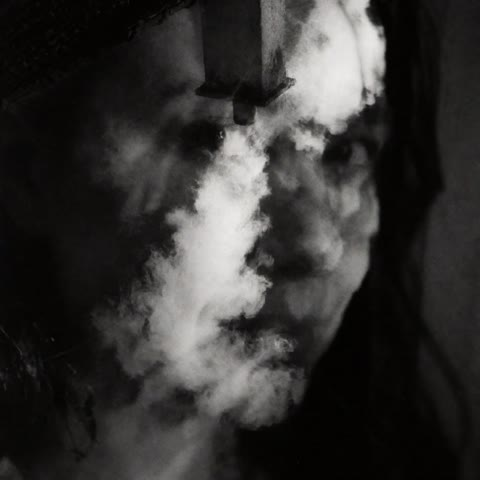
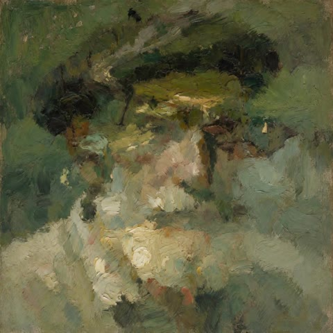
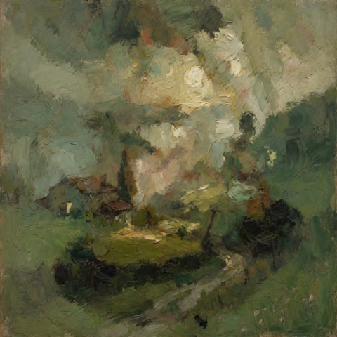
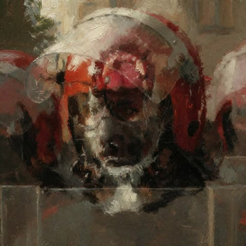
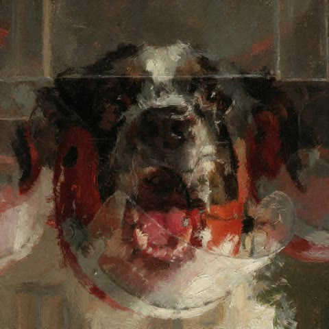

# ComfyUI-Anagrama

A ComfyUI guider node for **visual anagrams**: images that read as one thing as they are, and as something else when you rotate or flip them.

| View A | View B (rotated 180°) |
|---|---|
|  |  |
|  |  |
|  |  |

*Made with Krea 2 Turbo and Krea 2 Raw + turbo LoRA: 1024×1024, `rotate_180`, 8 steps, CFG 1, euler / simple.*

## How it works

This is a small implementation of [Visual Anagrams (Geng, Park & Owens, CVPR 2024)](https://dangeng.github.io/visual_anagrams/) as a ComfyUI **guider**.

At every sampling step the guider makes two predictions:

- prompt **A** on the latent as it is;
- prompt **B** on the transformed latent.

It undoes the transform on the second prediction and averages the two:

```
denoised = ( D(x, A) + V⁻¹( D(V(x), B) ) ) / 2
```

The views are permutations of the latent, so averaging the denoised predictions is the same as averaging noise or velocity. No training is needed, and it works on 4D `[B,C,H,W]` and 5D `[B,C,T,H,W]` latents (e.g. the Qwen-Image VAE used by Krea 2).

## Install

```bash
cd ComfyUI/custom_nodes
git clone https://github.com/BRRK-1312/ComfyUI-Anagrama
```

Restart ComfyUI. The nodes are in the `B_RR_K_/anagrama` category. There are no extra dependencies.

## Nodes

Both output a `GUIDER` and take the same `view` options.

| Node | What it does | Cost per step |
|---|---|---|
| **Anagrama Guider (Visual Anagrams)** | The base method: averages the two views 50/50. | 2× |
| **Anagrama Guider · Balance** | Mixes the views with a weight for B instead of 50/50. `weight_b` sets the base weight; `early_bias` adds extra weight for B at the start, when the composition is decided, and fades with σ. With 0.5 / 0 / 0 it matches the base node. `auto` is an experimental heuristic that didn't balance reliably in my tests, so it is off (0) by default. Prints σ and w_b to the console every step. | 2× |

## Usage

1. Replace your `KSampler` with **SamplerCustomAdvanced**, fed by `RandomNoise`, `KSamplerSelect`, your usual scheduler and an empty latent.
2. Connect **Anagrama Guider** or **Balance** to the `guider` input, with two `CLIPTextEncode` nodes (A and B) and your negative.
3. Pick a `view`:
   - `flip_vertical`
   - `flip_horizontal`
   - `rotate_180`
   - `rotate_90_cw` (needs a square resolution)
4. After `VAE Decode`, add the core **ImageFlip** or **ImageRotate** node with the same transform and a second preview, so you see both views.

**Check that it works:** the image as it is reads as A, and the transformed image reads as B.

## Tips

- Choose pairs whose shapes can double up: smoke and hair, trees and beards, roofs and hats.
- Painterly or abstract styles hide the seams best. Put the same style in both prompts and change only the subject. The paper's test pair is a good first try: *"an oil painting of people at a campfire"* / *"an oil painting of an old man"*.
- If both views come out as the same subject, try another seed or raise the CFG a little.
- If one view keeps losing, use **Balance** and push it with small steps. With Krea 2 Raw + turbo LoRA at 8 steps, `weight_b 0.5` + `early_bias 0.05` (≈0.55 for B at the first step) was the sweet spot for a village ↔ horse pair; 0.6 already started to erase the village. The margins are thin, so check a few seeds.
- Each step costs about two normal steps, so sampling is roughly twice as slow.

## Credits

- Method: Daniel Geng, Inbum Park, Andrew Owens, *Visual Anagrams: Generating Multi-View Optical Illusions with Diffusion Models*, CVPR 2024. [Project page](https://dangeng.github.io/visual_anagrams/) · [Code](https://github.com/dangeng/visual_anagrams) (MIT).
- View balancing: the idea of weighting the views comes from Xu et al., *Anagram-MTL* (WACV 2025), [code](https://github.com/Pixtella/Anagram-MTL). This version is a simpler reimplementation without CLIP.

## License

MIT, see [LICENSE](LICENSE).

---

B_RR_K_
